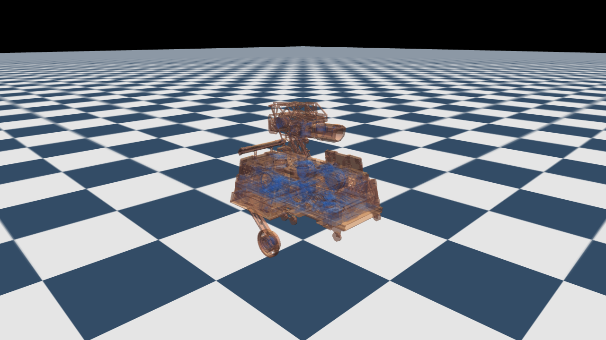
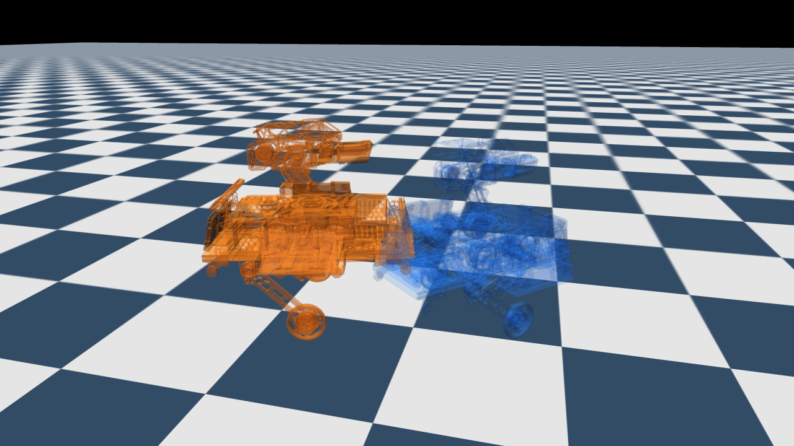
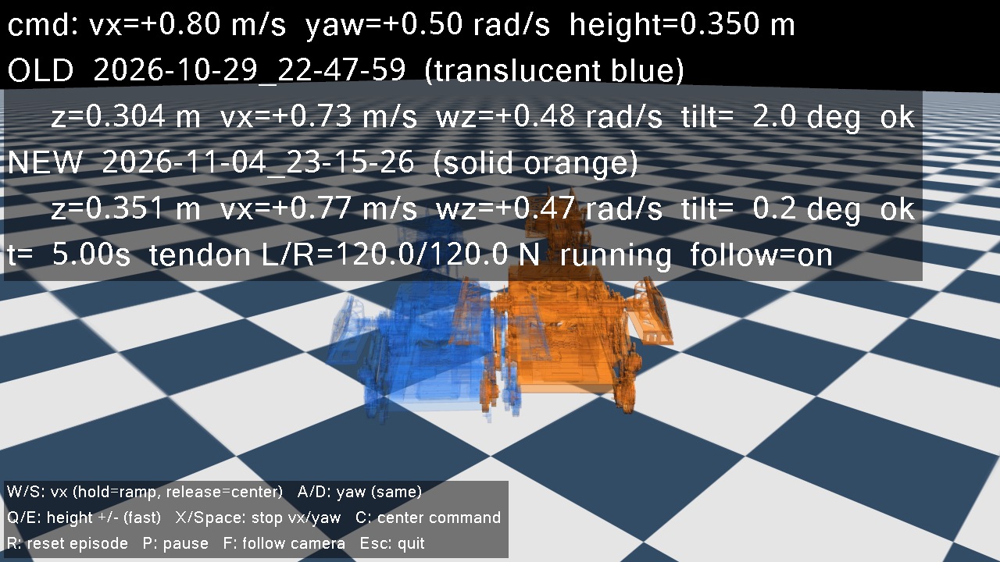

# policy_compare

在**同一个 MuJoCo 世界**里同时运行新旧两个 hero 轮腿机器人策略，并让两者接收**完全相同的初始状态与控制指令**：

- **旧策略**（默认 `2026-10-29_22-47-59`）：半透明蓝色渲染；
- **新策略**（默认 `2026-11-04_23-15-26`）：正常不透明橙色渲染；
- 两者初始根位置、姿态、关节角完全一致（`(0, 0, 0.32713)`）；
- 机器人与机器人之间**不产生碰撞**，但仍正常与地面接触。

| 同一初始位置（半透明旧策略叠在不透明新策略上） | 运动后分离 |
| --- | --- |
|  |  |

## 环境与依赖

项目使用 uv 管理虚拟环境（`.venv`，Python 3.11）。依赖已经通过 `uv add` 安装：

```toml
glfw >= 2.11.0
mujoco == 3.11.0
numpy >= 2.4.6
onnxruntime >= 1.31.1
```

重新同步环境：

```powershell
uv sync
```

## 运行

```powershell
uv run policy-compare
# 或者
.venv\Scripts\python.exe -m policy_compare
```

默认直接加载两个 run 目录下的 **ONNX actor**（不是训练检查点 `.pt`；ONNX 是从对应 checkpoint 导出的推理网络）：

```text
src/policy/2026-10-29_22-47-59/2026-10-29_22-47-59.onnx   -> old
src/policy/2026-11-04_23-15-26/2026-11-04_23-15-26.onnx   -> new
```

常用参数：

```powershell
# 指定策略：onnx 路径、run 目录或 src/policy 下的 run 名均可
uv run policy-compare --old 2026-10-29_22-47-59 --new 2026-11-04_23-15-26

# 初始指令：前进速度(m/s)、偏航角速度(rad/s)、机身高度(m)
uv run policy-compare --command 0.8 0.5 0.36

# 固定肌腱预紧力（默认每次 reset 在 90-150 N 之间随机，与训练一致）
uv run policy-compare --tendon-force 120

# 无窗口跑 10 秒（适合快速检查策略是否稳定）
uv run policy-compare --headless --duration 10 --command 0.8 0.0 0.33

# 任一机器人摔倒时自动重置两者
uv run policy-compare --auto-reset
```

其他参数：

| 参数 | 说明 |
| --- | --- |
| `--delay-steps N` | 执行器指令延迟的物理步数，默认 `2`（10 ms） |
| `--seed N` | 肌腱预紧力随机种子 |
| `--no-follow` | 关闭相机跟随（默认开启，按 `F` 切换） |
| `--no-keyboard` | 禁用键盘指令输入 |
| `--old-label` / `--new-label` | 覆盖界面显示名称 |

## 键盘控制

两个策略始终接收同一条指令，因此键盘操作会**同时**作用于两者。键盘输入只在 viewer 窗口获得焦点时生效。

**手柄摇杆式输入**：`W/S` 和 `A/D` 不是每按一次加减固定值，而是设定目标速度——按住时指令在 0.35 s 内平滑爬升到训练上限，松开后自动回落到 0；`Q/E` 调整机身高度指令，速度为 0.30 m/s（比旧版更快）。

| 按键 | 功能 |
| --- | --- |
| `W` / `S` | 前进速度目标 ±1.5 m/s，按住爬升、松开回零 |
| `A` / `D` | 偏航角速度目标 ±6 rad/s，按住爬升、松开回零 |
| `Q` / `E` | 机身高度指令 + / −（0.30 m/s） |
| `X` / `Space` | 立即将 vx/wz 清零（高度不变） |
| `C` | 指令复位为 `(0, 0, 0.33)` |
| `R` | 重置两个机器人到同一初始状态 |
| `P` | 暂停 / 继续 |
| `F` | 开关相机跟随 |
| `Esc` | 退出 |

指令会自动裁剪到训练范围：`vx ∈ [-1.5, 1.5] m/s`、`wz ∈ [-6, 6] rad/s`、`height ∈ [0.215, 0.465] m`。

鼠标：左键拖动旋转视角，右键拖动平移，滚轮缩放。

### 与 MuJoCo 内置快捷键的冲突

项目**不再使用** `mujoco.viewer` 自带窗口，而是用 `glfw` + `mjr_render` 实现了自己的 viewer（`viewer.py`）。因此 MuJoCo 内置的 `Space` 暂停、`C/F/P/X` 可视化开关、`W/A/S/D` 自由相机等快捷键全部不存在，不会和本项目的控制键互相干扰。代价是没有 MuJoCo 自带的 Options/Inspector 面板，视角和状态信息由鼠标相机与 HUD 提供。

## 实现说明

### 1. 一个世界、两个机器人

`src/policy_compare/model.py` 以 `hero.xml` 为模板，用 `MjSpec.attach(..., prefix="old/")` 和 `prefix="new/"` 把机器人复制两份到同一个模型里。每份副本都有独立的：

- 浮动基座、关节、闭链 equality 约束；
- position / velocity 执行器和肌腱恒力执行器；
- 传感器（陀螺仪）。

两者共用同一个地板、重力、求解器设置和时间步。

### 2. 互相无碰撞

训练用的碰撞配置 `FULL_COLLISION` 中，所有机器人碰撞几何都是：

```text
contype = 0
conaffinity = 1
```

因此：

- 机器人 vs 地面（`contype=1`）：`conaffinity & contype = 1`，正常碰撞；
- 机器人 vs 机器人：两边 `contype` 都是 0，永不生成接触。

这个性质与位置无关，所以两个机器人可以**完全重叠**地出生。程序在启动时和运行结束后都会检查是否存在跨机器人接触，正常情况下输出：

```text
[check] robots overlap at t=0 with no robot-robot contacts
```

### 3. 与训练一致的观测/动作

`env.yaml`、`hero_constants.py` 和 ONNX metadata 三者交叉核对后，实现了 25 维 actor 观测：

```text
base_ang_vel(3, ×0.5) + projected_gravity(3) + joint_pos(4)
+ joint_vel(6, 逐维缩放) + last_actions(6) + command(3, ×[1, 0.5, 5])
```

动作按训练配置拆成两项：

```text
hip position:  target_qpos  = default_joint_pos + 1.0 * action，再按关节裁剪
wheel velocity: target_vel   = 10.0 * action，裁剪到 ±30 rad/s
```

执行器参数取自 `hero_constants.py`：hip `kp=30, kd=1, effort=40 Nm`，wheel `kv=0.2, effort=6 Nm`，并包含每个关节的 armature / 粘滞阻尼 / 干摩擦。肌腱恒力执行器限幅 300 N。

### 4. 仿真设置

- 物理步长 `0.005 s`，`decimation=4`，即 **200 Hz 物理 / 50 Hz 策略**；
- MuJoCo `implicitfast` 积分器、Newton 求解器、`jacobian=auto`、`tolerance=1e-8`；
- `impratio=10`、椭圆摩擦锥、`iterations=20`、`ls_iterations=20`；
- 轮子接触 `condim=6`、priority=1、摩擦 `(1, 5e-3, 5e-4)`、`solref=(0.01, 1)`；
- 部署时不加观测噪声、不加 encoder bias、不做域随机化（使用名义参数）；
- 两个策略使用相同的固定指令延迟（默认 10 ms）和相同的肌腱预紧力。

### 5. 渲染

- 使用自定义 GLFW viewer（`viewer.py`），通过 `mjv_updateScene` + `mjr_render` 渲染，键盘只响应本项目绑定的按键；
- 旧策略的 visual geom 使用 `rgba = (0.15, 0.45, 1.0, 0.30)`，MuJoCo 会自动做 alpha 混合；
- 新策略使用不透明橙色；
- 碰撞 geom 位于 group 3 并在 viewer 中隐藏；
- 地板棋盘格直接参考 `scene_test.xml`：`rgb1=(0.2,0.3,0.4)`、`rgb2=(0.9,0.9,0.9)`、500×500 builtin checker、`specular=0.1`、`shininess=1`；由于 demo 地板更大，`texrepeat` 等比例放大以保持与参考场景相同的 1 m 棋盘周期。

viewer 内 HUD 示例：



## 目录结构

```text
src/policy_compare/
  app.py          # CLI、viewer 主循环、状态文字、键盘处理
  config.py       # 路径、关节顺序、观测/动作/执行器/指令常量
  model.py        # 由 hero.xml 构建双机器人 MuJoCo 模型
  policy.py       # ONNX actor 封装与 metadata 校验
  simulation.py   # 双策略闭环、观测拼接、动作裁剪、延迟、指标
  keyboard.py     # GLFW 按键状态与按下事件
  viewer.py       # 自定义 GLFW viewer（无 MuJoCo 内置快捷键）
  __main__.py     # python -m policy_compare
docs/             # 预览图
```

## 备注

- 对比时两个策略共享同一个肌腱预紧力、同一条指令、同一个初始状态，唯一差异是策略网络本身。
- 如果需要使用其他 checkpoint，建议先用训练工程重新导出 ONNX actor，再通过 `--old` / `--new` 指定。
- 渲染上的软阴影在 MuJoCo classic renderer 中会呈现为抖动噪点，因此默认关闭阴影；不影响物理与对比结果。